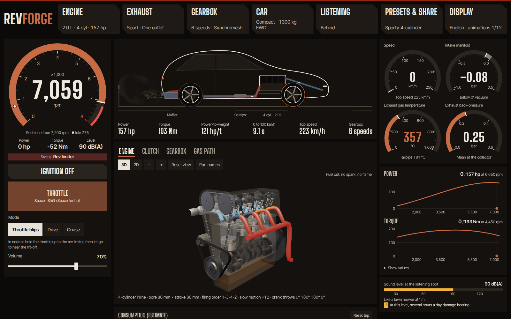

# Revforge

[English](README.md)

**Construis un moteur, monte-le dans une voiture, puis écoute-le d'où tu veux : une simulation physique en temps réel d'une voiture et de son son, avec un cœur C++20 sans dépendance, joué dans le navigateur grâce à WebAssembly.**

**[Essayer dans le navigateur](https://wasabules.github.io/revforge/?lang=fr)** (son activé, au casque si possible).

Il n'y a aucun échantillon sonore. Tout ce qu'on entend est calculé, échantillon par échantillon, par le modèle qui fait avancer la voiture : le couple vient du moteur que tu as construit, le régime de l'embrayage et de la boîte que tu as choisis, et le son de ce que fait le gaz en sortant.



## Ce qu'on peut faire

- **Construire le moteur.** Cylindres (de 2 à 16), architecture (en ligne, V, V8 croisé, boxer, rotatif, VR5 et VR6, W8, W12 et W16, chacun avec son vrai ordre d'allumage et ses manetons), cylindrée, alésage et course (le curseur ajuste la cylindrée), régime maximal, essence ou diesel, injection ou carburateurs, un turbo avec sa taille et sa pression, et un filtre à air (papier d'origine, panneau sport, cône à l'air libre, cornets). Puissance, couple, 0 à 100 km/h et vitesse de pointe découlent de ces réglages : rien n'est saisi à la main. Le temps de réponse du turbo vient d'un vrai bilan de puissance sur son arbre, et se sent dans la voiture : aussi avec deux turbos en parallèle ou en séquence, un twincharger (compresseur en amont du turbo, comme le 1.4 TSI de VW) ou une turbine à géométrie variable, chaque arbre avec son bilan et son sifflement.
- **Choisir la distribution.** Double arbre, simple arbre ou culbuteurs (arbre dans le bloc, poussoirs hydrauliques, tiges), avec des ressorts de soupape d'origine ou renforcés. Les soupapes s'affolent à un régime calculé depuis la masse en mouvement, la décélération de la came et le ressort : au-delà, le remplissage chute, les combustions se dispersent et les soupapes claquent sur leur siège.
- **Ou un deux-temps.** Des lumières calées par leur hauteur au lieu des soupapes, un carter qui pompe le mélange, une explosion par tour, de l'huile dans l'essence, des ratés au ralenti, et une chambre de détente accordée sur le moteur : son onde de retour fait la bande de puissance. Le couple vient du cycle intégré pas à pas.
- **Ou un compresseur.** Roots, à vis ou centrifuge, entraîné par une courroie : de la pression dès le bas ou seulement en haut, pas d'arbre à lancer, sa puissance prise au vilebrequin, et un sifflement qui suit le moteur.
- **Régler la combustion.** Taux de compression et carburant (SP95, SP98, essence de course, E85, méthanol) : rendement, couple et consommation en litres en découlent, et le cliquetis est calculé (Douaud-Eyzat, Livengood-Wu). Le capteur le corrige en retirant de l'avance ; un carburateur n'en a pas, et on l'entend cliqueter, à la fréquence de résonance de la chambre.
- **Choisir l'injection.** L'injection directe d'essence refroidit la charge et fait son tic sous le capot au ralenti ; la rampe commune d'un diesel et son injection pilote adoucissent le claquement et donnent du couple en bas ; la recirculation des gaz et le filtre à particules, avec sa suie, sa contre-pression et sa régénération, changent chacun la puissance, la consommation et le son.
- **Tailler la came.** Durée, levée et angle entre cames, un déphaseur ou deux profils : le remplissage vient d'un cycle de renouvellement des gaz calculé, le régime de bascule du croisement des deux courbes de couple, et une came pointue fait galoper le ralenti.
- **Refroidir la charge, ou l'enrichir.** Un échangeur air-air ou air-eau (son eau chauffe à chaque accélération), ou aucun ; une injection d'eau évaporée jusqu'à saturer l'air ; un kit de protoxyde dont la bouteille se vide et refroidit à mesure qu'on s'en sert.
- **Choisir l'échappement.** Confort, origine, sans résonateur, sport, sans silencieux ou ligne directe, avec une ou deux sorties, et un pont en H ou en X sur un moteur en V. Chaque ligne est calculée depuis sa géométrie.
- **Choisir la boîte, indépendamment du moteur.** Synchros, crabots, séquentielle, double embrayage ou convertisseur ; nombre de rapports, rapports issus de vrais nombres de dents, couple final, denture hélicoïdale ou droite, volant simple ou bi-masse. Une boîte mal adaptée a de vraies conséquences : on peut caler, manquer de vitesse ou la casser.
- **Conduire.** Démarreur, calage, embrayage qu'on fait patiner, coup de gaz au rétrogradage, grattement si on passe sans débrayer, marche arrière, rupteur, coupure d'injection, détonations, décharge du turbo. Les automatiques ont des modes Éco, Normal, Sport, Piste et palettes, avec des points de passage issus des courbes du moteur.
- **Choisir l'air du jour.** Température extérieure et altitude : la pression de l'atmosphère type, l'air que le moteur enferme (comparé à SAE J1349), un turbo qui tourne plus vite en montagne jusqu'à sa vitesse limite, la traînée, et un son qui voyage et s'éteint selon l'air du jour.
- **Régler le calculateur.** Avance et richesse à pleine charge, rupteur d'origine, progressif ou à coupure d'allumage (l'essence imbrûlée détone dans la ligne), launch control qui fait monter la pression à l'arrêt, passage à fond et antipatinage, chacun calculé depuis sa cause.
- **Partir en balade.** Neuf trajets, de la ville au col de montagne, du tour de circuit au départ arrêté ou au remorquage : la pente, les virages et la remorque se sentent sur la voiture.
- **Lire les jauges.** Un large tableau de bord : compte-tours, pression d'admission, température et contre-pression des gaz, températures d'eau et d'huile, puissance et couple sur leurs courbes, consommation estimée d'essence et d'huile. Chaque aiguille lit une valeur simulée. Les réglages sont dans des panneaux latéraux : on entend chaque changement en le faisant.
- **Se placer où l'on veut.** Glisse-toi autour de la voiture sur un plan vu de dessus, ou saute devant, derrière, sur le côté, l'oreille dans le pot, dans l'habitacle ou sous le capot. Les sources sont à leur vraie place, en vraie stéréo, avec un niveau estimé en dB(A).
- **S'asseoir à bord.** L'habitacle dépend de l'isolation (de la voiture de course dépouillée à la berline de luxe), de l'emplacement du moteur (avant, central ou arrière) et des vitres ouvertes ou fermées.
- **Voir à l'intérieur, en 2D ou en 3D.** Un vilebrequin aux bons manetons pour chaque architecture, pistons, soupapes, arbres à cames, chaîne de distribution, bougies d'allumage ou de préchauffage. Un embrayage avec sa vraie butée, qui prend de la vitesse au contact des doigts du diaphragme. Une boîte reconstruite selon tes réglages, avec les vrais nombres de dents, toujours en prise.
- **Une page qui chauffe.** La couleur d'accent est une vraie température de la simulation : métal froid au repos, incandescent à pleine charge.
- **Voir le gaz et les données.** Un gaz calculé par un vrai solveur de fluide, de la boîte à air au panache de sortie, en passant par le turbo et l'échangeur, et des graphiques à la demande : courbes dans le temps, spectrogramme, réponse de la ligne.
- **Ralentir, ou pas.** Les animations tournent à 1/12, à 1/4 ou en temps réel. En temps réel, comme sur un vrai moteur, l'œil ne suit plus les pièces au-delà de 2 000 tr/min environ.

Le site existe en anglais et en français.

## Essayer

Il faut [Emscripten](https://emscripten.org/docs/getting_started/downloads.html), qui fournit aussi Node, ainsi que CMake et Ninja.

```bash
scripts/build_wasm.sh    # compile le moteur vers web/public/revforge.wasm
cd web
npm ci
npm run dev              # ou : npm run build && npm run preview
```

| Commande | Clavier | Manette |
|---|---|---|
| Accélérateur | Espace ou ↑ (Maj : à mi-course) | gâchette droite, progressive |
| Frein | B ou ↓ | gâchette gauche, progressive |
| Embrayage (manuelle) | C | bouton A |
| Rapports (manuelle ou palettes) | ← et → ; ← depuis le point mort pour la marche arrière | boutons d'épaule |
| Redémarrer après un calage | D | |

## Écouter sans navigateur

La même simulation rend un WAV en ligne de commande :

```bash
cmake -S . -B build -G Ninja
cmake --build build
./build/revforge-render --list
./build/revforge-render --preset v8_cross_plane --scenario blips --out v8.wav
./build/revforge-render --preset v8_cross_plane --scenario start --out demarrage.wav

# Un V8 en ligne directe, en stéréo, derrière et à gauche, avec son niveau estimé
./build/revforge-render --preset v8_cross_plane --exhaust straight --routing dual \
    --at -4,1.5,1.7 --stereo 1 --db 1 --scenario launch --out derriere.wav

# Ton propre moteur, depuis l'habitacle d'une voiture dépouillée
./build/revforge-render --cylinders 5 --cc 2500 --bore 82 --redline 7000 --aspiration turbo --boost 1.5 \
    --exhaust sport --pops strong --body compact --mass 1400 --rim 18 --drive all \
    --gearbox dog --teeth spur --listener cabin --insulation stripped --scenario launch --out cinq.wav
```

Autres options utiles : `--turbo small|medium|large`, `--turbo-pipe MM`, `--boost-control spring|electronic|by_gear`, `--filter stock|panel|cone|stacks`, `--carb injection|single|multi`, `--shift-mode`, `--drive-scenario`, et `--fuel 1` avec `--out none` pour la consommation. `--help` donne la liste complète.

## Comment le son est fabriqué

Le schéma de la chaîne est dans le [README anglais](README.md#how-the-sound-is-made).

- **Le modèle de conduite** intègre couple, inertie, embrayage, boîte et pneus à pas fixe de 1 ms, et pilote le son avec le régime et la charge *réels* du moteur.
- **La ligne d'échappement est calculée depuis sa géométrie** par matrices de transfert acoustiques (tubes, catalyseur, résonateur, silencieux, sortie libre), puis appliquée par convolution partitionnée. Tout le gaz la traverse : les harmoniques défilent devant un timbre fixe, au lieu d'entraîner les résonances avec elles.
- **Chaque source est en pascals à 1 m**, puis voyage jusqu'à l'auditeur : 1/r et retard (donc Doppler), directivité de la sortie selon Levine et Schwinger, absorption de l'air selon ISO 9613-1, réflexion au sol, masquage par la caisse selon Maekawa, modèle de tête sphérique selon Brown et Duda. Aucun gain par position.
- **Le bruit de boîte vient de ses causes :** erreur de transmission à la fréquence d'engrènement, qui suit les arbres et non le moteur, et claquement au ralenti calculé d'après les roues folles dans leur jeu, qui s'arrête quand on débraye.
- **Un vrai sonomètre** (pondération A de l'IEC 61672, constante « fast ») donne le chiffre en dB(A). Le niveau est ensuite comprimé pour tes haut-parleurs, qui ne peuvent pas jouer de 40 à 130 dB.

La physique, la calibration et toutes les cibles sont dans [docs/modele.md](docs/modele.md) ([in English](docs/model.md)).

## Quelle confiance lui accorder

C'est un simulateur réglé à l'oreille et à la mesure, pas un instrument de mesure.

- **Les dB(A) sont des estimations**, comparées à des valeurs d'essai publiées. Aucun micro ne les a contrôlés.
- **De bonnes mesures n'ont jamais suffi à faire un bon son.** Les premiers démarreurs avaient le bon rythme et le bon spectre moyen, et ne ressemblaient en rien à un démarreur. Tout changement de son passe donc par l'écoute, et `tools/perceptual_compare.py` est un guide, pas un verdict.
- **Les enregistrements de référence ne sont pas dans ce dépôt.** De vrais enregistrements (par exemple de [La Sonothèque](https://lasonotheque.org/)) et quelques sons générés n'ont servi qu'à comparer. Rien du son livré n'en provient.

Limites connues :

- Distinguer l'avant de l'arrière au casque reste difficile : le modèle stéréo n'a pas de HRTF.
- Le ralenti du 4 cylindres sportif sort de la plage des vrais moteurs au comparateur, et reste trop haché.
- À plein gaz, le limiteur resserre l'écart entre les lignes : environ 6 dB joués pour environ 22 dB estimés entre l'origine et la ligne directe.
- Les vues 2D et 3D simplifient une partie de la mécanique (automatique schématique, double embrayage approché, culasse à culbuteurs toujours dessinée en coin, soupapes en ligne) et n'ont pas été vérifiées sur beaucoup de cartes graphiques. Sans carte graphique, la 3D passe en rendu plus grossier et tourne lentement ; le bouton 2D reste fluide.
- Un départ à froid ne compte que le moteur (huile épaisse, ralenti accéléré, essence en plus, le starter sur un carburateur) : ni huile de boîte, ni pneus froids, ni chauffe du catalyseur, si bien que son surcoût lit environ moitié moins que les chiffres publiés. L'enrichissement, les masses du moteur et le dimensionnement du radiateur sont supposés. Parti chaud ou froid, les températures agissent par leur écart à la référence chaude (90 °C d'eau, 100 °C d'huile), et tous les moteurs ont un échangeur eau-huile à plaques, la Cadillac de 1930 comprise ; plusieurs constantes du film et du souffle sont supposées. La carte du cliquetis d'un moteur d'origine n'est pas calculée : au-delà de 94 à 100 °C d'eau, à pleine charge, il commencerait à cliqueter, ce que le simulateur ne montre pas. La chaleur du compartiment que lit la boucle air-eau reste celle d'un moteur chaud. Le démarrage est calculé : une batterie au plomb dimensionnée sur le moteur (EN 50342-1), le démarreur qu'elle alimente, l'huile de l'époque du moteur (SAE J300) et chaque explosion du lancement. Moteur chaud par 20 °C, rien ne change, au bit près. Par −30 °C, un moteur moderne se lance à 105 à 170 tr/min et prend en 1,4 à 2,6 s ; la Cadillac de 1930, en SAE 30 d'été, ne démarre pas sous −16 °C environ. Le premier cycle se vaporise à l'équilibre, plus que mesuré, le délai d'un diesel est calé moteur tournant, et le film d'huile ne chauffe pas pendant le lancement.
- L'affolement des soupapes vient d'une distribution à un degré de liberté, dont les ressorts d'origine sont dimensionnés pour la zone rouge avec une marge supposée : environ 11 % au-dessus d'elle sur chaque préréglage. Le tic des poussoirs et le claquement des soupapes affolées n'ont pas encore été écoutés. Sans carte graphique, la 3D passe en rendu plus grossier et tourne lentement ; le bouton 2D reste fluide.
- La consommation estimée lit environ 15 à 25 % au-dessus des chiffres officiels, et l'huile n'est qu'un ordre de grandeur, à un facteur trois près.
- À cylindrée égale, la course ne change le couple qu'au-delà de 24 m/s de vitesse de piston, et ne change jamais le frottement, l'inertie ni la consommation.
- La voiture ne recule jamais (démarrage en côte avec maintien supposé), toutes les voitures ont la même adhérence, et les trajets sont réglés en durée, pas en distance.
- En automatique, un diesel peut parfois caler à très faible vitesse ; le site propose alors de le relancer.
- Le pneu a un sommet d'adhérence (la formule magique de Pacejka, sommet vers 11 % de glissement, 0,76 de lui en patinage franc), mais une seule adhérence sèche pour toutes les voitures, les deux roues d'un essieu réunies, ni glissement combiné en virage, ni sensibilité à la charge ; ses coefficients viennent de trois chiffres publiés, cités de mémoire. Sans antipatinage, pied au plancher, les propulsions puissantes patinent au-delà du sommet et perdent jusqu'à 2,4 s sur un 0 à 100, et le pilote automatique ne lève pas le pied ; la fiche mesure un essayeur qui dose la pédale, à une bande passante et un retard humains supposés. Sans antipatinage, le launch control fait patiner au lâcher les quatre roues de la 2.0 turbo, dont le faisceau air-air encore froid laisse tout le couple, et ne lui fait plus gagner de temps (6,59 s contre 6,57). Le meilleur couple et le coût d'un décalage d'avance viennent du cycle du cliquetis, avec ses pertes aux parois pas à pas (Woschni) : 0,9 % à 5°, 3,4 % à 10°, comme la corrélation d'Ayala et Heywood, mais une étincelle tardive n'y brûle pas plus lentement, et coûte donc un peu moins que mesuré à l'étincelle (1,3 et 5,1 %). Les détonations du rupteur et du launch control restent supposées tant que personne ne les a écoutées.
- L'anti-lag n'use rien : rien ne calcule l'usure, donc aucune pièce ne casse et aucune durée n'est limitée, et ses détonations restent supposées tant que personne ne les a écoutées.
- Le claquement de boîte n'a aucun vrai enregistrement isolé pour comparaison, et plusieurs paramètres de boîte (module, angle d'hélice, jeu, vitesse d'usure) sont supposés.
- L'anti-lag et le tube déporté ne sont modélisés que sur un turbo simple. Sur deux turbos, la régulation électronique et selon le rapport pilotent les deux soupapes par une électrovanne étalonnée sur leur banc, mais l'étagement d'un séquentiel creuse plus (jusqu'à 0,5 bar pendant 0,3 s) qu'avec la loi des soupapes. Avec deux turbos, le gain des collecteurs séparés aux bouffées mieux espacées n'est pas compté, et la géométrie variable ne se voit pas dans le gaz à l'écran.
- La longueur du tube du turbo change son retard, son gaz et ses vues, mais le sifflement vient toujours du compartiment moteur, même sur un turbo déporté à l'arrière, et les réflexions d'onde dans ce tube ne sont pas dans le son.
- Le moteur rotatif ne simule ni usure ni segments d'apex, et son calage de lumières et son dosage d'huile viennent de mémoire, sans recoupement sur un manuel constructeur. Sa vue du moteur ne montre qu'en schéma ce qui se branche sur ses lumières.
- Le deux-temps lit environ 28 % sous la Saab 96 dont il s'inspire, en couple et en puissance ; ses largeurs de lumières, son taux réel et sa limite d'allumage sont supposés. Seuls l'essence, l'atmosphérique et l'admission par la jupe du piston sont simulés, et son ralenti ring-ding n'a pas été écouté.
- La vue du gaz suit le modèle de conduite sans agir sur lui : ses pressions ne recoupent donc pas exactement le couple affiché.
- Pendant le glissé d'un curseur, la fiche, le son et les pièces de la vue du moteur attendent que le curseur s'arrête (150 ms) : chacun coûte trop pour suivre chaque mouvement (jusqu'à 120 ms pour la fiche, 28 ms sur le thread du son, 180 ms pour la 3D). Le 0 à 100 et la fiche acoustique se calculent dans un worker, quelques dixièmes de seconde après le réglage.
- Le niveau du sifflement du compresseur est supposé, sans enregistrement de référence ; ni la détonation à forte pression ni l'inertie des rotors ne sont modélisées ; l'échauffement à l'arrêt ne vient que du faisceau de l'échangeur.
- Certaines valeurs réglementaires (ONU R51.03 et UE 540/2014) restent à contrôler sur les textes officiels.
- La régulation électronique de la pression n'a pas de cible à charge partielle (le papillon garde son rôle), les temps de son électrovanne sont supposés et son ondulation à 25 Hz est moyennée.
- La carrosserie des années 80 garde la résistance au roulement et l'adhérence de pneus récents, et sa surface frontale et sa faible isolation sont supposées.
- Les VR et les W : la numérotation des cylindres du VR6 et du W16, l'ordre d'allumage du V16 (celui de Cadillac n'a pas été trouvé) et celui du V14 (aucune voiture de série n'en a eu ; calculé pour l'équilibre) sont supposés, le frottement ne dépend pas du nombre de paliers, et la distribution dessinée d'un VR ou d'un W est approchée.
- L'air du jour garde 50 % d'humidité, et l'altitude ne le refroidit pas : la température se règle à part. Le réchauffement de l'air piégé par les parois est calé sur l'exposant de SAE J1349. Le radiateur, le cliquetis, l'échangeur, le cycle de la came, les arbres du biturbo, la cible de pression et la fiche d'une régulation électronique lisent l'air du jour.
- Le son dépend de la fréquence d'échantillonnage : les bruits filtrés gardent leur variance par échantillon (−6 dB à 192 kHz). Le site calcule toujours à 48 kHz ; la CLI à `--rate`.
- Le cliquetis vient d'un cycle à une zone aux constantes supposées ; il ne coûte que l'avance retirée (ni usure ni casse), et son son (niveau, durée) attend encore l'écoute.
- Le film de carburant d'une injection indirecte lit l'eau du réseau thermique ; le tic des injecteurs est calé sur une seule étude publiée, et à pleine charge la combustion d'une rampe commune sort de 2 à 4 dB au-dessus de la pompe, un résultat du modèle que personne n'a vérifié. Un filtre à particules démarre à mi-chemin entre deux régénérations : une régénération se voit rarement dans un trajet.
- Le cycle calculé de la came n'a pas d'échappement accordé à elle : une came de course y gagne moins en haut et perd moins de dépression au ralenti qu'en réel ; la consommation ne voit pas ses gaz résiduels, et le gaz à l'écran ne suit pas le déphaseur ni la bascule en direct. Personne n'a encore écouté le ralenti qui galope.
- L'air de charge : l'échangeur air-air est un faisceau ε-NTU refroidi par l'air de route, avec la masse de son aluminium ; la fiche suppose une soufflerie de banc qui vaut 100 km/h, et les conduits et le collecteur chauds, qui font l'essentiel d'un vrai échauffement à l'arrêt, ne sont pas modélisés. La boucle air-eau, l'injection d'eau et la bouteille de protoxyde sont calculées, mais plusieurs tailles sont supposées, l'air extérieur est sec, et la bouteille refroidit d'un bloc : sa pression baisse moins vite que ne le rapportent les préparateurs.

## Organisation

| Dossier | Contenu |
|---|---|
| `core/` | La simulation : son, acoustique, ligne d'échappement, démarreur, boîte, puissance et modèle de conduite |
| `presets/presets.json` | Les moteurs proposés, source unique pour le C++ et le site |
| `cli/` | Rendu WAV en ligne de commande |
| `wasm/` | Interface C pour WebAssembly |
| `web/` | Le site : AudioWorklet, TypeScript, Svelte 5, vues canvas et three.js, solveur du gaz |
| `tests/`, `web/tests/` | Tests C++ (doctest) et tests du navigateur (Playwright) |
| `tools/` | Analyse, comparaison perceptive, parité natif et WebAssembly |
| `docs/` | [Le modèle et sa calibration](docs/modele.md) |

`CLAUDE.md` est la carte la plus complète du code : architecture, invariants, et ce qui doit rester synchronisé.

## Règles d'ingénierie

- **Temps réel :** `EngineSound::render` n'alloue jamais et ne prend aucun verrou ; un test le vérifie.
- **La taille des blocs ne change rien :** tout état évolue par échantillon.
- **Au bit près partout :** natif et WebAssembly produisent le même son, vérifié par `tools/check_wasm.mjs`.
- **Changer le son est un choix :** CTest compare des empreintes du son, donc tout changement se voit et doit être voulu.
- **Les tests sont contre-éprouvés :** un test de son doit échouer quand on retire ce qu'il protège. Cela a déjà révélé plusieurs tests aveugles.
- **Limites du WebAssembly :** ni exceptions ni RTTI, 4 Mo de mémoire fixe, aucun import.

## Tests

```bash
ctest --test-dir build                                                     # moteur et empreintes du son
source ~/emsdk/emsdk_env.sh                                                # fournit node
node tools/check_wasm.mjs build-wasm/revforge.wasm build/revforge-render   # WebAssembly = natif, au bit près
cd web && npx playwright install chromium firefox                          # une première fois
npm run check && npm run build && npx playwright test                      # site, dans Chromium et Firefox
```

Lis [CONTRIBUTING.md](CONTRIBUTING.md) avant de modifier quoi que ce soit.

## Remerciements

L'approche doit beaucoup à [engine-sim](https://github.com/ange-yaghi/engine-sim) d'AngeTheGreat et au [Sound Design Toolkit](https://github.com/SkAT-VG/SDT). Les travaux publiés derrière le modèle sont cités dans [docs/modele.md](docs/modele.md). Les vrais démarrages mesurés viennent de [La Sonothèque](https://lasonotheque.org/).

## Licence

[MIT](LICENSE). `tests/vendor/doctest.h` : [doctest](https://github.com/doctest/doctest), MIT. Les vues 3D du site utilisent [three.js](https://threejs.org/), MIT, chargé seulement quand une vue 3D s'affiche ; les polices sont Big Shoulders Display et Inter Tight, sous licence SIL Open Font. Le cœur C++ ne dépend de rien.
