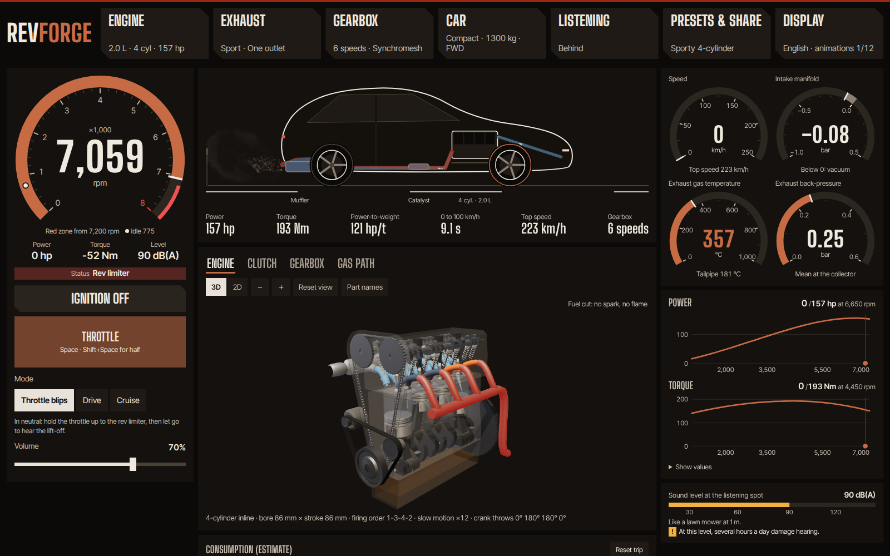
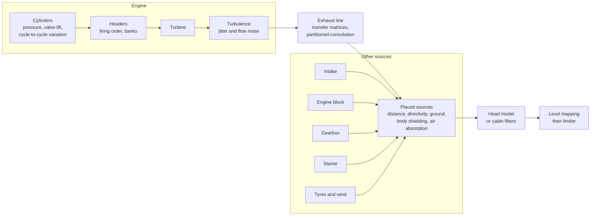

# Revforge

[Français](README.fr.md)

**Build an engine, fit it to a car, then listen to it from anywhere: a real-time physical simulation of a car and its sound, with a dependency-free C++20 core played in the browser through WebAssembly.**

**[Try it in your browser](https://wasabules.github.io/revforge/)** (sound on, ideally with headphones).

There are no audio samples. Everything you hear is computed sample by sample from the same model that makes the car move: the torque comes from the engine you built, the engine speed from the clutch and gearbox you chose, and the sound from what the gas does on its way out.



## What you can do

- **Build the engine.** Cylinders (2 to 16), layout (inline, V, cross-plane V8, boxer, rotary, VR5 and VR6, W8, W12 and W16, each with its real firing order and crankpins), displacement, bore and stroke (the slider adjusts the displacement), redline, petrol or diesel, injection or carburetors, a turbo with its size and boost, and an air filter (stock paper, sport panel, open cone, velocity stacks). Power, torque, 0–100 km/h and top speed all follow from these settings; none of them is typed in by hand. Turbo lag comes from a real shaft power balance, and you feel it in the car: also with parallel or sequential twin turbos, a twincharger (supercharger ahead of the turbo, as on VW's 1.4 TSI) or variable-geometry vanes, each shaft with its own balance and its own whistle.
- **Choose the valvetrain.** Twin cam, single cam or pushrods (cam in the block, hydraulic lifters, rocker arms), with stock or stiff valve springs. The valves float at a speed computed from the moving mass, the cam's deceleration and the spring: beyond it, filling drops, combustion turns ragged and the valves clatter on their seats.
- **Or a supercharger.** Roots, twin-screw or centrifugal, driven by a belt: pressure from low revs or only near the top, no shaft to spin up, its power taken from the crank, and a whine that follows the engine.
- **Tune the combustion.** Compression ratio and fuel (RON 95, RON 98, race fuel, E85, methanol): efficiency, torque and fuel use in litres follow, and knock is computed (Douaud-Eyzat, Livengood-Wu). The knock sensor corrects it by taking advance away; carburettors have none, and you hear them knock, at the chamber's resonance.
- **Choose the fuel injection.** Petrol direct injection cools the charge and ticks under the bonnet at idle; a diesel's common rail and its pilot injection soften the knock and add torque low down; exhaust gas recirculation and a particulate filter, with its soot, back-pressure and regeneration, each change power, fuel use and sound.
- **Grind the cam.** Duration, lift and lobe separation, a cam phaser or two profiles: the filling comes from a calculated gas-exchange cycle, the switch-over speed from where both torque curves cross, and a wild cam makes the idle lope.
- **Cool the charge, or add to it.** An air-to-air or air-to-water intercooler (its water warms with each pull), or none at all; water injection evaporated until the air is saturated; a nitrous kit whose bottle empties and cools as you use it.
- **Or a two-stroke.** Ports set by their height instead of valves, a crankcase that pumps the charge, one firing per turn, oil mixed into the petrol, misfires at idle, and an expansion chamber tuned on the engine: its returning wave makes the power band. Torque comes from the cycle integrated step by step.
- **Choose the exhaust.** Comfort, stock, no resonator, sport, muffler delete or straight pipe, with one or two outlets and an H or X pipe on V engines. Each line is computed from its geometry.
- **Choose the gearbox, independently of the engine.** Synchromesh, dog box, sequential, dual clutch or torque converter; number of gears, ratios built from real tooth counts, final drive, helical or straight-cut gears, single or dual-mass flywheel. A badly matched gearbox has real consequences: you can stall, run out of speed, or break it.
- **Drive it.** Starter, stalling, a clutch you can slip, rev-matching, grinding when you shift without the clutch, reverse, rev limiter, fuel cut, pops and bangs, turbo blow-off. Automatics offer Eco, Normal, Sport, Track and paddle shift modes, with shift points derived from the engine's curves.
- **Choose the day's air.** Outside temperature and altitude: the standard atmosphere's pressure, the air the engine traps (compared with SAE J1349), a turbo that spins faster up a mountain until it reaches its speed limit, drag, and sound that travels and fades with the day's air. The engine starts as a car parked outside overnight, coolant and oil at the outside temperature, or after half an hour or two hours parked, cooled by the thermal network itself, or just driven.
- **Tune the engine management.** Spark advance and full-load mixture, a stock, soft or ignition-cut rev limiter (the unburnt fuel bangs in the exhaust), launch control that builds boost at a standstill, flat shifting and slip control, each one computed from its cause.
- **Go for a ride.** Nine journeys, from city traffic to a mountain pass, a track lap, a drag run or towing a trailer, with slopes, corners and the trailer felt by the car.
- **Watch the gauges.** A wide dashboard with tachometer, manifold pressure, exhaust temperature and back-pressure, coolant and oil temperatures, power and torque on their curves, and estimated fuel and oil consumption. Every needle reads a simulated value. Settings live in side panels, so you hear each change as you make it.
- **Stand wherever you want.** Drag yourself around the car on a top-down map, or jump to front, rear, side, ear in the tailpipe, cabin or under the hood. Sources sit at their real positions, in true stereo, with an estimated dB(A) reading.
- **Sit inside.** The cabin depends on the insulation (from stripped race car to luxury saloon), the engine location (front, mid or rear) and whether the windows are open.
- **See inside, in 2D or 3D.** A crankshaft with the right throws for each layout, pistons, valves, camshafts, timing chain, spark or glow plugs. A clutch with its real release bearing, spinning up when it touches the diaphragm fingers. A gearbox rebuilt from your settings, with the real tooth counts, in constant mesh.
- **A page that heats up.** The accent color is a real temperature from the simulation: cold metal at rest, glowing at full load.
- **See the gas and the data.** Gas computed by a real fluid solver from the air box, through the turbo and intercooler, to the exhaust plume, and on-demand charts: time traces, spectrogram and exhaust line response.
- **Slow it down, or not.** Animations run at 1/12, 1/4 or real time. In real time, as on a real engine, your eye can't follow the parts above roughly 2,000 rpm.

The site is available in English and French.

## Try it

You need [Emscripten](https://emscripten.org/docs/getting_started/downloads.html), which also provides Node, plus CMake and Ninja.

```bash
scripts/build_wasm.sh    # compiles the engine to web/public/revforge.wasm
cd web
npm ci
npm run dev              # or: npm run build && npm run preview
```

| Control | Keyboard | Gamepad |
|---|---|---|
| Throttle | Space or ↑ (Shift: half throttle) | right trigger, progressive |
| Brake | B or ↓ | left trigger, progressive |
| Clutch (manual) | C | A button |
| Shift (manual or paddles) | ← and →; ← from neutral for reverse | shoulder buttons |
| Restart after a stall | D | |

## Listen without a browser

The same simulation renders to WAV from the command line:

```bash
cmake -S . -B build -G Ninja
cmake --build build
./build/revforge-render --list
./build/revforge-render --preset v8_cross_plane --scenario blips --out v8.wav
./build/revforge-render --preset v8_cross_plane --scenario start --out start.wav

# A straight-piped V8, heard in stereo from behind and to the left, with its estimated level
./build/revforge-render --preset v8_cross_plane --exhaust straight --routing dual \
    --at -4,1.5,1.7 --stereo 1 --db 1 --scenario launch --out behind.wav

# Your own engine, from the cabin of a stripped car
./build/revforge-render --cylinders 5 --cc 2500 --bore 82 --redline 7000 --aspiration turbo --boost 1.5 \
    --exhaust sport --pops strong --body compact --mass 1400 --rim 18 --drive all \
    --gearbox dog --teeth spur --listener cabin --insulation stripped --scenario launch --out five.wav
```

Other useful options: `--turbo small|medium|large`, `--turbo-pipe MM`, `--boost-control spring|electronic|by_gear`, `--filter stock|panel|cone|stacks`, `--carb injection|single|multi`, `--shift-mode`, `--drive-scenario`, and `--fuel 1` with `--out none` for consumption figures. `--help` lists everything.

## How the sound is made



- **The driving model** integrates torque, inertia, clutch, gearbox and tyres at a fixed 1 ms step, and drives the sound with the engine's *real* speed and load.
- **The exhaust line is computed from its geometry** with acoustic transfer matrices (pipes, catalyst, resonator, muffler, open end), then applied by partitioned convolution. All of the gas goes through it, so harmonics sweep past a fixed timbre instead of dragging resonances along with them.
- **Every source is in pascals at 1 m**, then travels to the listener: 1/r and delay (so Doppler), tailpipe directivity after Levine and Schwinger, ISO 9613-1 air absorption, ground reflection, shielding by the body after Maekawa, and a spherical head model after Brown and Duda. No per-position gains.
- **The gearbox noise comes from its causes:** transmission error at tooth-mesh frequency, following the shafts rather than the engine, and idle rattle computed from loose gears in their backlash, which stops when you press the clutch.
- **A real level meter** (IEC 61672 A-weighting, fast) produces the dB(A) figure. The level then gets compressed for your speakers, because they can't play 40 to 130 dB.

The physics, the calibration and every target are in [docs/model.md](docs/model.md) ([en français](docs/modele.md)).

## How far to trust it

This is a simulator tuned by ear and by measurement, not a measuring instrument.

- **The dB(A) figures are estimates**, compared with published test values. No microphone has checked them.
- **Good measurements have not meant good sound.** Early starter versions had the right rhythm and average spectrum, and sounded nothing like a starter. Every sound change therefore goes through listening, and `tools/perceptual_compare.py` is a guide rather than a verdict.
- **Reference recordings are not in this repository.** Real recordings (for example from [La Sonothèque](https://lasonotheque.org/)) and a few generated sounds were used for comparison only. Nothing in the shipped sound comes from them.

Known limits:

- Telling front from back on headphones is weak: the stereo model has no HRTF.
- The idle of the sporty 4-cylinder scores outside the range of real engines in the comparator, and is too choppy.
- At full throttle, the limiter narrows the gap between exhaust lines: about 6 dB as played for about 22 dB estimated from stock to straight pipe.
- The 2D and 3D views simplify some mechanics (schematic automatic, approximate dual clutch, a pushrod head always drawn as a wedge with its valves in line) and have not all been checked on many graphics cards.
- Valve float comes from a one-degree-of-freedom valvetrain whose stock springs are sized for the redline with an assumed margin: about 11 % above it on every preset. The pushrod tick and the clatter of floating valves have not been listened to yet. Without a GPU, 3D falls back to a coarser look and runs slowly; the 2D switch stays smooth.
- Estimated fuel consumption reads about 15 to 25% high against official figures, and oil is an order of magnitude within a factor of three.
- At equal displacement, the stroke only changes torque above 24 m/s of piston speed, and never changes friction, inertia or consumption.
- A cold start only counts the engine (thick oil, fast idle, extra fuel, the choke on a carburetor): no gearbox oil, cold tyres or catalyst heating, so its fuel penalty reads about half of published figures. The enrichment schedule, the engine masses and the radiator sizing are assumed. Warm or cold, the temperatures act through their gap to the warm reference (90 °C coolant, 100 °C oil), and every engine gets a plate oil cooler, the 1930 Cadillac included; several film and noise constants are assumed. A stock engine's knock map is not computed: above 94 to 100 °C coolant at full load it would start knocking, which the simulator does not show. The under-bonnet heat read by the air-to-water loop stays that of a warm engine. Every preset starts and holds its idle at −20 °C, and at −30 °C, with the starter or set running at idle. The site starts overnight, everything at the outside air, while the command line and the fingerprints keep the warm engine; an old link, which did not write the warm start, now starts cold. Engine off, the cooling has no under-bonnet air node: the block and the sump give their heat straight to the outside air, at a still-air coefficient that is assumed and held constant whatever the cold or the wind, and the night is exactly the outside air, where the network would leave 0.3 to 2.2 K after 12 hours.
- The car never rolls backwards (hill starts assume hill hold), all cars share one tyre grip, and journeys are timed rather than distance-based.
- With an automatic, a diesel can occasionally stall at very low speed; the site then offers a restart.
- The tyre has a grip peak (Pacejka's magic formula, peak near 11 % slip, 0.76 of it when spinning freely), but a single dry grip shared by every car, both wheels of an axle merged, no combined slip with cornering and no load sensitivity; its coefficients come from three published figures quoted from memory. Without slip control, foot to the floor, powerful rear-wheel drives spin past the peak and lose up to 2.4 s on a 0-100, and the autopilot does not lift off; the spec sheet measures a tester who modulates the pedal, at an assumed human bandwidth and delay. Without slip control, launch control spins all four wheels of the turbo 2.0 at release, its still-cold air-to-air core leaving it all its torque, and no longer gains it any time (6.59 s against 6.57). Best torque and the cost of a spark offset come from the knock model's cycle with step-by-step wall losses (Woschni): 0.9% at 5°, 3.4% at 10°, as Ayala and Heywood's correlation, but a late spark does not burn more slowly, so it costs a little less than measured against the spark (1.3 and 5.1%). The limiter and launch control bangs are assumed until someone listens.
- Anti-lag wears nothing out: nothing computes wear, so no part breaks and no time limit applies, and its bangs are assumed until someone listens.
- Gear rattle has no isolated real recording to compare against, and several gearbox parameters (module, helix angle, backlash, wear rate) are assumed.
- The rotary engine has no simulated wear or apex seals, and its port timing and oil metering are from memory, not checked against a manufacturer's manual. Its engine view shows what connects to its ports in outline only.
- The two-stroke reads about 28 % below the Saab 96 it is drawn from, in torque and power; its port widths, trapped compression and ignition limit are assumed. Only petrol, natural aspiration and a piston-port inlet are simulated, and its ring-ding idle has not been listened to.
- The gas view follows the driving model without feeding back into it, so its pressures do not exactly match the displayed torque.
- While a slider is dragged, the spec sheet, the sound and the parts of the engine view wait for it to stop (150 ms): each costs too much to follow every movement (up to 120 ms for the spec sheet, 28 ms on the sound thread, 180 ms for the 3D). The 0-100 and the sound sheet are computed in a worker, a few tenths of a second after the setting.
- Anti-lag and the remote turbo pipe are only modelled on a single turbo. On twin turbos, electronic and by-gear boost control drive both wastegates with one solenoid calibrated on their bench, but the sequential staging dips deeper (up to 0.5 bar for 0.3 s) than with the spring law. On twin turbos, the gain of split headers with better-spaced pulses is not counted, and variable geometry does not show in the on-screen gas.
- The turbo's pipe length changes its lag, its gas and its views, but the whine still comes from the engine bay, even on a rear-mounted turbo, and the pipe's own wave reflections are not in the sound.
- The supercharger's whine level is assumed, not fitted to recordings, and knock at high boost and the rotors' inertia are not modelled; heat soak only comes from the intercooler core.
- Some regulatory values (UN R51.03 and EU 540/2014) still need checking against the official texts.
- The 80s coupe body keeps the rolling resistance and grip of recent tyres, and its frontal area and light soundproofing are assumptions.
- VR and W engines: the cylinder numbering of the VR6 and the W16, the V16's firing order (Cadillac's was not found) and the V14's (no road car ever had one; computed for balance) are assumptions, friction does not depend on the number of main bearings, and the drawn VR and W valvetrain is approximate.
- The day's air keeps a fixed 50% humidity, and the altitude does not cool it: temperature is set separately. The wall heating of the trapped air is fitted to SAE J1349's exponent. The radiator, knock, the intercooler, the cam cycle, the twin turbo's shafts, the boost target and the spec sheet of electronic boost control read the day's air.
- The sound depends on the sample rate: filtered noises keep their per-sample variance (−6 dB at 192 kHz). The site always computes at 48 kHz; the CLI at `--rate`.
- Knock comes from a single-zone cycle with assumed constants; it only costs the advance taken away (no wear, no failure), and its sound (level, duration) still awaits listening.
- The port-injection fuel film reads the thermal network's coolant; the injector tick levels are calibrated on one published study, and at full load the common rail's combustion noise comes out 2 to 4 dB above the pump's, a model result nobody has checked. A particulate filter starts halfway between regenerations, so a regeneration rarely shows in a trip.
- The cam's gas-exchange cycle has no exhaust tuning matched to the cam, so a race cam gains less up top and loses less idle vacuum than in reality; consumption does not see its residual gas, and the on-screen gas does not follow the phaser or the profile switch live. Nobody has listened to the lumpy idle yet.
- Electronic boost control has no part-load target (the throttle keeps its role), its solenoid valve's timings are assumed and its 25 Hz ripple is averaged.
- Charge air: the air-to-air intercooler is an ε-NTU core cooled by road air, with the mass of its aluminium; the spec sheet assumes a dyno fan worth 100 km/h, and the hot pipes and manifold that make most of a real heat soak are not modelled. The air-to-water loop, water injection and the nitrous bottle are computed, but several sizes are assumed, outside air is dry, and the bottle cools as a single lump, so its pressure falls more slowly than tuners report.

## Repository layout

| Path | Contents |
|---|---|
| `core/` | The simulation: sound, acoustics, exhaust line, starter, gearbox, power and driving model |
| `presets/presets.json` | The engines on offer, the single source for C++ and the site |
| `cli/` | WAV rendering from the command line |
| `wasm/` | C interface for WebAssembly |
| `web/` | The site: AudioWorklet, TypeScript, Svelte 5, canvas and three.js views, gas solver |
| `tests/`, `web/tests/` | C++ tests (doctest) and browser tests (Playwright) |
| `tools/` | Analysis, perceptual comparison, native/WASM parity check |
| `docs/` | [The model and its calibration](docs/model.md) |

`CLAUDE.md` is the most complete map of the code: architecture, invariants, and what has to stay in sync.

## Engineering rules

- **Real time:** `EngineSound::render` never allocates and takes no lock; a test checks it.
- **Block size doesn't matter:** every state evolves per sample.
- **Bit-exact everywhere:** native and WebAssembly produce the same sound, checked by `tools/check_wasm.mjs`.
- **Changing the sound is a decision:** CTest compares audio fingerprints, so any change shows up and must be chosen.
- **Tests are counter-tested:** a sound test must fail when what it protects is removed. This has already exposed several blind tests.
- **WebAssembly limits:** no exceptions or RTTI, 4 MB of fixed memory, no imports.

## Tests

```bash
ctest --test-dir build                                                     # engine and sound fingerprints
source ~/emsdk/emsdk_env.sh                                                # provides node
node tools/check_wasm.mjs build-wasm/revforge.wasm build/revforge-render   # WebAssembly = native, bit for bit
cd web && npx playwright install chromium firefox                          # the first time
npm run check && npm run build && npx playwright test                      # site, in Chromium and Firefox
```

See [CONTRIBUTING.md](CONTRIBUTING.md) before changing anything. Code comments, test names and commit messages are in French, as the project grew up that way; the site, the command line and the main documents are in English.

## Credits

The approach owes a lot to [engine-sim](https://github.com/ange-yaghi/engine-sim) by AngeTheGreat and to the [Sound Design Toolkit](https://github.com/SkAT-VG/SDT). Published work behind the model is cited in [docs/model.md](docs/model.md). Real starter recordings used for measurement came from [La Sonothèque](https://lasonotheque.org/).

## License

[MIT](LICENSE). `tests/vendor/doctest.h` is [doctest](https://github.com/doctest/doctest), MIT. The site's 3D views use [three.js](https://threejs.org/), MIT, loaded only when a 3D view is shown; the typefaces are Big Shoulders Display and Inter Tight, under the SIL Open Font License. The C++ core depends on nothing.
