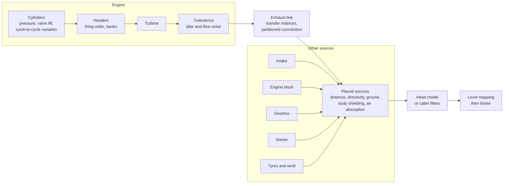

# Revforge

[Français](README.fr.md)

**Build an engine, fit it to a car, then listen to it from anywhere: a real-time physical simulation of a car and its sound, with a dependency-free C++20 core played in the browser through WebAssembly.**

**[Try it in your browser](https://wasabules.github.io/revforge/)** (sound on, ideally with headphones).

There are no audio samples. Everything you hear is computed sample by sample from the same model that makes the car move: the torque comes from the engine you built, the engine speed from the clutch and gearbox you chose, and the sound from what the gas does on its way out.


## What you can do

- **Build the engine.** Cylinders (2 to 12), layout, displacement, bore and stroke (the slider adjusts the displacement), redline, petrol or diesel, a turbo with its size and boost, and an air filter (stock paper, sport panel, open cone, velocity stacks). Power, torque, 0–100 km/h and top speed all follow from these settings; none of them is typed in by hand. Turbo lag comes from a real shaft power balance, and you feel it in the car.
- **Choose the exhaust.** Comfort, stock, no resonator, sport, muffler delete or straight pipe, with one or two outlets and an H or X pipe on V engines. Each line is computed from its geometry.
- **Choose the gearbox, independently of the engine.** Synchromesh, dog box, sequential, dual clutch or torque converter; number of gears, ratios built from real tooth counts, final drive, helical or straight-cut gears, single or dual-mass flywheel. A badly matched gearbox has real consequences: you can stall, run out of speed, or break it.
- **Drive it.** Starter, stalling, a clutch you can slip, rev-matching, grinding when you shift without the clutch, reverse, rev limiter, fuel cut, pops and bangs, turbo blow-off. Automatics offer Eco, Normal, Sport, Track and paddle shift modes, with shift points derived from the engine's curves.
- **Go for a ride.** Nine journeys, from city traffic to a mountain pass, a track lap, a drag run or towing a trailer, with slopes, corners and the trailer felt by the car.
- **Watch the gauges.** A wide dashboard with tachometer, manifold pressure, exhaust temperature and back-pressure, power and torque on their curves, and estimated fuel and oil consumption. Every needle reads a simulated value. Settings live in side panels, so you hear each change as you make it.
- **Stand wherever you want.** Drag yourself around the car on a top-down map, or jump to front, rear, side, ear in the tailpipe, cabin or under the hood. Sources sit at their real positions, in true stereo, with an estimated dB(A) reading.
- **Sit inside.** The cabin depends on the insulation (from stripped race car to luxury saloon), the engine location (front, mid or rear) and whether the windows are open.
- **See inside, in 2D or 3D.** A crankshaft with the right throws for each layout, pistons, valves, camshafts, timing chain, spark or glow plugs. A clutch with its real release bearing, spinning up when it touches the diaphragm fingers. A gearbox rebuilt from your settings, with the real tooth counts, in constant mesh.
- **A page that heats up.** The accent color is a real temperature from the simulation: cold metal at rest, glowing at full load.
- **See the gas and the data.** Gas computed by a real fluid solver from the air box, through the turbo and intercooler, to the exhaust plume, and on-demand charts: time traces, spectrogram and exhaust line response.
- **Slow it down, or not.** Animations run at 1/12, 1/4 or real time. In real time, as on a real engine, your eye can't follow the parts above roughly 2,000 rpm.

The site is available in English and French.

## Try it

You need [Emscripten](https://emscripten.org/docs/getting_started/downloads.html), which also provides Node, plus CMake and Ninja.

```bash
scripts/build_wasm.sh    # compiles the engine to web/public/revforge.wasm
cd web
npm ci
npm run dev              # or: npm run build && npm run preview
```

| Control | Keyboard | Gamepad |
|---|---|---|
| Throttle | Space or ↑ (Shift: half throttle) | right trigger, progressive |
| Brake | B or ↓ | left trigger, progressive |
| Clutch (manual) | C | A button |
| Shift (manual or paddles) | ← and →; ← from neutral for reverse | shoulder buttons |
| Restart after a stall | D | |

## Listen without a browser

The same simulation renders to WAV from the command line:

```bash
cmake -S . -B build -G Ninja
cmake --build build
./build/revforge-render --list
./build/revforge-render --preset v8_cross_plane --scenario blips --out v8.wav
./build/revforge-render --preset v8_cross_plane --scenario start --out start.wav

# A straight-piped V8, heard in stereo from behind and to the left, with its estimated level
./build/revforge-render --preset v8_cross_plane --exhaust straight --routing dual \
    --at -4,1.5,1.7 --stereo 1 --db 1 --scenario launch --out behind.wav

# Your own engine, from the cabin of a stripped car
./build/revforge-render --cylinders 5 --cc 2500 --bore 82 --redline 7000 --aspiration turbo --boost 1.5 \
    --exhaust sport --pops strong --body compact --mass 1400 --rim 18 --drive all \
    --gearbox dog --teeth spur --listener cabin --insulation stripped --scenario launch --out five.wav
```

Other useful options: `--turbo small|medium|large`, `--turbo-pipe MM`, `--filter stock|panel|cone|stacks`, `--shift-mode`, `--drive-scenario`, and `--fuel 1` with `--out none` for consumption figures. `--help` lists everything.

## How the sound is made



- **The driving model** integrates torque, inertia, clutch, gearbox and tyres at a fixed 1 ms step, and drives the sound with the engine's *real* speed and load.
- **The exhaust line is computed from its geometry** with acoustic transfer matrices (pipes, catalyst, resonator, muffler, open end), then applied by partitioned convolution. All of the gas goes through it, so harmonics sweep past a fixed timbre instead of dragging resonances along with them.
- **Every source is in pascals at 1 m**, then travels to the listener: 1/r and delay (so Doppler), tailpipe directivity after Levine and Schwinger, ISO 9613-1 air absorption, ground reflection, shielding by the body after Maekawa, and a spherical head model after Brown and Duda. No per-position gains.
- **The gearbox noise comes from its causes:** transmission error at tooth-mesh frequency, following the shafts rather than the engine, and idle rattle computed from loose gears in their backlash, which stops when you press the clutch.
- **A real level meter** (IEC 61672 A-weighting, fast) produces the dB(A) figure. The level then gets compressed for your speakers, because they can't play 40 to 130 dB.

The physics, the calibration and every target are in [docs/model.md](docs/model.md) ([en français](docs/modele.md)).

## How far to trust it

This is a simulator tuned by ear and by measurement, not a measuring instrument.

- **The dB(A) figures are estimates**, compared with published test values. No microphone has checked them.
- **Good measurements have not meant good sound.** Early starter versions had the right rhythm and average spectrum, and sounded nothing like a starter. Every sound change therefore goes through listening, and `tools/perceptual_compare.py` is a guide rather than a verdict.
- **Reference recordings are not in this repository.** Real recordings (for example from [La Sonothèque](https://lasonotheque.org/)) and a few generated sounds were used for comparison only. Nothing in the shipped sound comes from them.

Known limits:

- Telling front from back on headphones is weak: the stereo model has no HRTF.
- The idle of the sporty 4-cylinder scores outside the range of real engines in the comparator, and is too choppy.
- At full throttle, the limiter narrows the gap between exhaust lines: about 6 dB as played for about 22 dB estimated from stock to straight pipe.
- The 2D and 3D views simplify some mechanics (schematic automatic, approximate dual clutch, DOHC valvetrain everywhere) and have not all been checked on many graphics cards. Without a GPU, 3D falls back to a coarser look and runs slowly; the 2D switch stays smooth.
- Estimated fuel consumption reads about 15 to 25% high against official figures, and oil is an order of magnitude within a factor of three.
- At equal displacement, the stroke only changes torque above 24 m/s of piston speed, and never changes friction, inertia or consumption.
- The car never rolls backwards (hill starts assume hill hold), all cars share one tyre grip, and journeys are timed rather than distance-based.
- With an automatic, a diesel can occasionally stall at very low speed; the site then offers a restart.
- Gear rattle has no isolated real recording to compare against, and several gearbox parameters (module, helix angle, backlash, wear rate) are assumed.
- The gas view follows the driving model without feeding back into it, so its pressures do not exactly match the displayed torque.
- The turbo's pipe length changes its lag, its gas and its views, but the whine still comes from the engine bay, even on a rear-mounted turbo, and the pipe's own wave reflections are not in the sound.
- Some regulatory values (UN R51.03 and EU 540/2014) still need checking against the official texts.
- The 80s coupe body keeps the rolling resistance and grip of recent tyres, and its frontal area and light soundproofing are assumptions.

## Repository layout

| Path | Contents |
|---|---|
| `core/` | The simulation: sound, acoustics, exhaust line, starter, gearbox, power and driving model |
| `presets/presets.json` | The engines on offer, the single source for C++ and the site |
| `cli/` | WAV rendering from the command line |
| `wasm/` | C interface for WebAssembly |
| `web/` | The site: AudioWorklet, TypeScript, Svelte 5, canvas and three.js views, gas solver |
| `tests/`, `web/tests/` | C++ tests (doctest) and browser tests (Playwright) |
| `tools/` | Analysis, perceptual comparison, native/WASM parity check |
| `docs/` | [The model and its calibration](docs/model.md) |

`CLAUDE.md` is the most complete map of the code: architecture, invariants, and what has to stay in sync.

## Engineering rules

- **Real time:** `EngineSound::render` never allocates and takes no lock; a test checks it.
- **Block size doesn't matter:** every state evolves per sample.
- **Bit-exact everywhere:** native and WebAssembly produce the same sound, checked by `tools/check_wasm.mjs`.
- **Changing the sound is a decision:** CTest compares audio fingerprints, so any change shows up and must be chosen.
- **Tests are counter-tested:** a sound test must fail when what it protects is removed. This has already exposed several blind tests.
- **WebAssembly limits:** no exceptions or RTTI, 4 MB of fixed memory, no imports.

## Tests

```bash
ctest --test-dir build                                                     # engine and sound fingerprints
source ~/emsdk/emsdk_env.sh                                                # provides node
node tools/check_wasm.mjs build-wasm/revforge.wasm build/revforge-render   # WebAssembly = native, bit for bit
cd web && npx playwright install chromium firefox                          # the first time
npm run check && npm run build && npx playwright test                      # site, in Chromium and Firefox
```

See [CONTRIBUTING.md](CONTRIBUTING.md) before changing anything. Code comments, test names and commit messages are in French, as the project grew up that way; the site, the command line and the main documents are in English.

## Credits

The approach owes a lot to [engine-sim](https://github.com/ange-yaghi/engine-sim) by AngeTheGreat and to the [Sound Design Toolkit](https://github.com/SkAT-VG/SDT). Published work behind the model is cited in [docs/model.md](docs/model.md). Real starter recordings used for measurement came from [La Sonothèque](https://lasonotheque.org/).

## License

[MIT](LICENSE). `tests/vendor/doctest.h` is [doctest](https://github.com/doctest/doctest), MIT. The site's 3D views use [three.js](https://threejs.org/), MIT, loaded only when a 3D view is shown; the typefaces are Big Shoulders Display and Inter Tight, under the SIL Open Font License. The C++ core depends on nothing.
